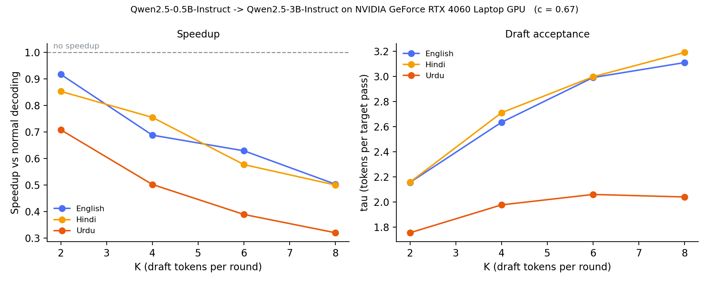

# Does Speculative Decoding Work Beyond English?

Measuring how speculative decoding's speedup and draft acceptance change for **English, Hindi and Urdu** on a **consumer laptop GPU** (RTX 4060, 8 GB).

## Idea
- LLMs generate one token per forward pass of the full model, which is slow.
- **Speculative decoding:** a small *draft* model guesses `K` tokens ahead; the large *target* model verifies them all in one pass and keeps the ones it agrees with. Output is identical to normal decoding.
- The speedup depends on how often the draft's guesses are accepted. Small models are weaker outside English, so acceptance (and speedup) may drop for Hindi and Urdu.

## The one equation

> `speedup ≈ tau / (1 + K·c)`

| | |
|---|---|
| `tau` | tokens produced per target forward pass (normal decoding = 1.0) |
| `K` | tokens the draft guesses per round |
| `c` | cost of a draft forward pass ÷ cost of a target forward pass |

You only win when **`tau > 1 + K·c`**. At batch size 1 the GPU is idle most of the time and the cost is dominated by Python and kernel-launch overhead, which barely depends on model size — so `c` is far closer to 1 than the 6x parameter ratio suggests. The benchmark measures `c` directly before anything else, because it sets the ceiling on every other result.

## Setup
| | |
|---|---|
| Target | `Qwen/Qwen2.5-3B-Instruct` (fp16) |
| Draft | `Qwen/Qwen2.5-0.5B-Instruct` (fp16) |
| Decoding | greedy (`repetition_penalty=1.0`), max 128 new tokens |
| Prompts | 10 parallel questions per language (`prompts.json`) |
| Hardware | NVIDIA RTX 4060 Laptop GPU, 8 GB |

**Metrics**
- `c`: draft ms/pass ÷ target ms/pass, measured on each model alone
- `speedup`: speculative tokens/sec ÷ normal tokens/sec
- `tau`: tokens per target forward pass, counted with a forward hook; reported pooled (total tokens ÷ total passes)
- `identical`: speculative output matches the canonical baseline output exactly
- `tokens_per_word` / `chars_per_token`: how much text each language gets per token
- Answers not in the asked language are detected by Unicode script and excluded

## Method notes

Three things that are easy to get wrong, and that the first version of this benchmark got wrong:

1. **Hugging Face does not leave `K` alone.** In transformers 4.57 the defaults are `num_assistant_tokens=20`, `num_assistant_tokens_schedule="constant"`, `assistant_confidence_threshold=0.4`. So `K` is a constant 20, cut short by a confidence stopping criterion. Worse, when scikit-learn is installed, `update_candidate_strategy` fits an ROC curve and **writes the new threshold back onto `draft.generation_config`**, where it survives into the next `generate()` call — and the next prompt, and the next language. `set_draft_strategy()` re-pins all three before every call and sets the threshold to `0`, which disables both the early exit and the write-back.
2. **Run order is shuffled** (fixed seed). With a fixed en → hi → ur order, any thermal drift lands on whichever language runs last, which looks exactly like a language effect.
3. **Every condition is repeated and aggregated by median.** The first run had one Urdu trial where the normal *and* speculative runs collapsed together (9.7 and 3.1 tok/s) — a transient that a mean would have baked into the result.

Also: Qwen ships `repetition_penalty` 1.05 (3B) and 1.1 (0.5B) in `generation_config`, so "greedy" is not argmax unless you override it, and the two models would be penalised by different amounts. The benchmark sets it to 1.0 explicitly.

## Results

Final run: `repetition_penalty = 1.05`, 10 prompts x 3 languages x {baseline, K=2,4,6,8} x 2 repeats = 300 runs, shuffled order, median aggregation, GPU clock verified steady throughout.

**Forward-pass cost:** target 34.6 ms, draft 23.1 ms -> **`c = 0.67`**. A 0.5B pass costs 67% of a 3B pass, not the ~17% its size implies, because at batch 1 the cost is Python and kernel-launch overhead, not FLOPs.

### Draft acceptance (tau, tokens per target forward pass)

| K | English | Hindi | **Urdu** |
|---|---|---|---|
| 2 | 2.16 | 2.16 | **1.76** |
| 4 | 2.64 | 2.71 | **1.98** |
| 6 | 2.99 | 3.00 | **2.06** |
| 8 | 3.11 | 3.19 | **2.04** |

- **Hindi is not degraded.** It tracks English at every K; per-prompt, Hindi < English in only 4-5 of 10 questions.
- **Urdu is.** Per-prompt, **Urdu < Hindi in 10/10 questions at every K**, and Urdu < English in 9-10/10.
- **Urdu plateaus.** English and Hindi keep climbing with K; Urdu flattens at ~2.0. The drafter cannot produce runs of correct Urdu beyond ~2 tokens however many it is allowed to guess.
- The effect is **robust to decoding config**: it holds at `repetition_penalty` 1.0 and 1.05, and is *larger* at 1.05. At 1.0 the model fell into repetition loops in Urdu, which are trivially predictable and were inflating Urdu's tau.

### Speedup

| Language | normal tok/s | best K | speedup |
|---|---|---|---|
| English | 26.8 | 2 | 0.92x |
| Hindi | 27.1 | 2 | 0.85x |
| Urdu | 27.5 | 2 | 0.71x |

**No K beat normal decoding.** With `c = 0.67` a win needs `tau > 1 + K*c`; at K=2 that means tau > 2.33, and the best measured is 2.16. Predicted vs observed agrees within a few percent for all three languages, so the whole result follows from one number.

### Tokenizer tax

| | tokens/word | chars/token | chars for 128 tokens |
|---|---|---|---|
| English | 1.19 | 5.04 | ~614 |
| Urdu | 3.12 | 1.44 | ~184 |
| Hindi | 4.66 | 1.06 | ~136 |

English gets ~4.5x more text per token than Hindi. Same budget, a paragraph vs a sentence.



### Caveats

- `identical` ran 70-100%. Speculative decoding is output-identical in exact arithmetic; in fp16 the verify pass batches positions differently, so near-tied logits can flip. At one measured divergence the top-2 logits were adjacent representable fp16 values (`' atmosphere'` 31.76562 vs `' air'` 31.75000, gap = half an fp16 step). A precision artifact, not a bug.
- Urdu output quality is poor regardless of decoding config - the 3B target hallucinates in Urdu. That is consistent with the finding rather than a confound, but it means acceptance is measured on weak text.
- `results/` holds the earlier `repetition_penalty = 1.0` run, kept for the robustness comparison.


## Run it
```bash
# 1. PyTorch with CUDA (example: CUDA 12.1)
pip install torch --index-url https://download.pytorch.org/whl/cu121
# 2. The rest
pip install -r requirements.txt
# 3. Run
jupyter notebook benchmark.ipynb          # annotated, step by step
python benchmark.py --limit 2 --repeats 1 # or as a script, quick smoke test
python benchmark.py                       # full sweep: K in {2,4,6,8}, 10 prompts, 2 repeats
```
First run downloads ~7 GB of model weights. The full sweep takes roughly 45–60 min on an RTX 4060; `--limit 2 --repeats 1` takes a few minutes.

On a gaming laptop, run it plugged in and on the highest performance profile. Power profile alone moved throughput from 13 to 29 tok/s on this machine, which is larger than every effect being measured.

## Outputs
| file | what |
|---|---|
| `results/sweep.png` | speedup vs K and tau vs K, one line per language |
| `results/speedup.png` | best-K speedup per language, bar chart |
| `results/summary.json` | per-language, per-K table plus `c` |
| `results/raw.csv` | every individual trial |
| `results/outputs.json` | the actual generated answers |

## Related work
- Leviathan et al., *Fast Inference from Transformers via Speculative Decoding*, ICML 2023
- Chen et al., *Accelerating LLM Decoding with Speculative Sampling*, 2023
- Yan et al., *Decoding Speculative Decoding*, NAACL 2025 — draft **latency** matters more than draft quality, which is the same `c` term as above
- Yi et al., *Towards Fast Multilingual LLM Inference: Speculative Decoding and Specialized Drafters*, EMNLP 2024

This repo's contribution is narrow and deliberately so: an **off-the-shelf** small drafter, on **Hindi and Urdu**, on a **consumer laptop GPU**. Multilingual speculative decoding itself is not new.
