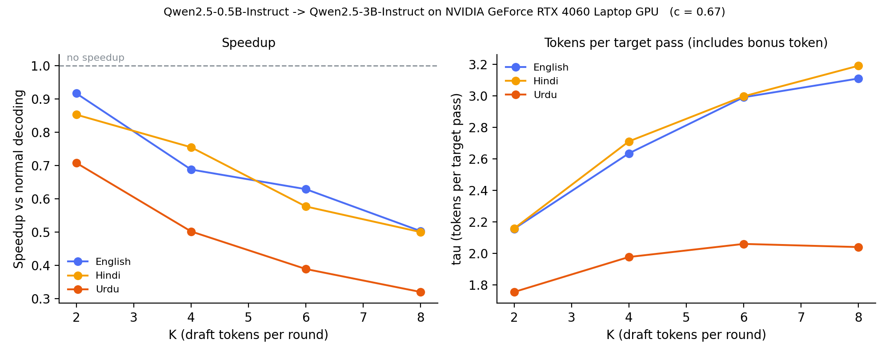

# Speculative decoding beyond English: a laptop benchmark

English, Hindi and Urdu; Qwen2.5-0.5B-Instruct drafting for Qwen2.5-3B-Instruct; Hugging Face Transformers on an RTX 4060 Laptop GPU (8 GB).

## What the data supports

- Every tested K lost median throughput against the target-only baseline.
- Hindi and English were similar in tokens produced per target forward pass. This is descriptive, not a formal equivalence test.
- Urdu was lower than Hindi on all ten translated questions at every K in the final run.
- Exact outputs matched in **194/240 speculative trials (80.8%)**. A targeted probe now demonstrates a numerical tie change for one case; other historical mismatches remain unexamined.

Read [DATA_REVIEW.md](DATA_REVIEW.md) before making slides. It includes integrity checks, paired question comparisons, repeat-specific estimates, matching-output sensitivity and limitations. Reproduce with `python audit_data.py`; no GPU is needed.

## Mechanism and metrics

A draft model guesses up to K tokens. The target verifies them in one forward call, keeps the matching prefix, and supplies a correction or bonus token. The algorithm preserves the target's decoding behavior under its assumptions; this FP16 implementation did not match every baseline exactly. [Original algorithm](https://proceedings.mlr.press/v202/leviathan23a.html).

| Metric | Meaning |
|---|---|
| Speedup | Median of per-question speculative/baseline tokens-per-second ratios; each condition first takes the median over repeats |
| Pooled tau | Total generated tokens / total target forward calls; includes the target correction/bonus token |
| c | Draft/target end-to-end generation time per token in a calibration run; includes prefill and bookkeeping |
| Exact match | Generated token IDs equal the first baseline's IDs for that question |
| Text measures | Tokens per whitespace segment and Unicode code points per token; descriptive, not answer-quality scores |

Tau is not an acceptance percentage. One target forward call can cover several positions and cost more than a single-position call.

The approximate model is `speedup ≈ tau / (1 + K*c)`. It assumes K draft steps per round and verification cost comparable to one baseline step. EOS, the final token budget, cache work and bookkeeping can violate these simplifications. It is an explanation to test, not a measured causal breakdown.

## Final local setup

| Setting | Value |
|---|---|
| Target / draft | Qwen/Qwen2.5-3B-Instruct / Qwen/Qwen2.5-0.5B-Instruct |
| Precision / batch | FP16 / 1 |
| Decoding | Deterministic selection with repetition_penalty=1.05; maximum 128 new tokens |
| Questions | 10 parallel questions in each of three languages |
| Conditions | Target-only baseline and K=2,4,6,8 |
| Repeats / order | 2 per condition; shuffled with seed 0 |
| Recorded sweep trials | 300 final + 300 earlier = 600 |
| Final evidence | results_rp105/raw.csv, summary.json, outputs.json; archived executed notebook |

Transformers is pinned to 4.57.6. The strategy is reset before each assisted call: constant K and confidence threshold 0, preventing adaptive confidence state from carrying across prompts. The assistant uses the target's generation configuration/logits processors in this implementation; its standalone default repetition penalty does not establish that different penalties were applied inside assisted generation.

Two-repeat medians equal two-value means, so one slow trial still affects them. Future defaults use three repeats. Post-run GPU clock samples detect some changes; they do not prove steady conditions throughout a run.

K=1 was not measured historically. New defaults include it. “No tested K wins” does not establish that every possible K loses.

## Results

Final calibration: target **34.64 ms/token**, draft **23.13 ms/token**, **c=0.668**. Both models were resident and generated separately. This used one 64-token measurement per model after warm-up. It does not isolate Python overhead, kernel latency or memory bandwidth. New runs retain three interleaved calibration measurements per model.

| Language | Baseline tok/s | Best tested K | Median speedup |
|---|---:|---:|---:|
| English | 26.8 | 2 | 0.92× |
| Hindi | 27.1 | 2 | 0.85× |
| Urdu | 27.5 | 2 | 0.71× |

| K | English pooled tau | Hindi pooled tau | Urdu pooled tau |
|---|---:|---:|---:|
| 2 | 2.157 | 2.159 | 1.756 |
| 4 | 2.636 | 2.712 | 1.978 |
| 6 | 2.992 | 2.998 | 2.061 |
| 8 | 3.111 | 3.192 | 2.042 |

Urdu's pooled tau changes little from K=6 to K=8. That does not imply a hard limit of two accepted tokens. Hindi's similar tau does not mean identical speed: workloads and timings also matter.

The approximation differs from final observed medians by up to **8.3% relative**. It is broadly consistent with added draft work outweighing saved target calls, but cannot prove the cause or rule out a bug.



The Urdu ordering survives in available exact-match outputs, with fewer common questions (see DATA_REVIEW.md). The earlier repetition_penalty=1.0 attribution comes from project notes; its summary lacks that field. Both settings show lower pooled Urdu tau, but altered text trajectories prevent a causal claim that repetition alone explains the difference.

## Text budget and limitations

| Language | Tokens/whitespace segment | Unicode characters/token |
|---|---:|---:|
| English | 1.19 | 5.04 |
| Hindi | 4.66 | 1.06 |
| Urdu | 3.12 | 1.44 |

English yields roughly 4.8 times as many Unicode characters per token as Hindi in these samples. This measures different generated text, not identical translated reference text; it does not isolate tokenizer quality. Some English answers stop before 128 tokens, while all Hindi/Urdu baselines reach the ceiling.

- Ten curated questions and one model pair limit generalization. Translations and answer quality were not independently scored.
- Historical Unicode scores used canonical baseline text and were copied to every condition. They cannot certify divergent speculative answers. New code screens every actual output and retains every trial's text and token IDs.
- Script is not language or quality: Arabic-script text is not necessarily fluent Urdu.
- The new targeted probe reproduces an `exams` → `exam` divergence at generated token 13. With identical prefix and cloned KV caches, changing only one-position versus multi-position target scoring changes the selected token through a score tie. This demonstrates FP16/forward-shape sensitivity for this case, not a diagnosis of every historical mismatch. See analysis/correctness_probe.json and its saved logits.
- The old FP16 spacing explanation was incorrect: around 31.75, binary16 spacing is 0.015625, so the reported gap was one ULP, not half a ULP.
- Cross-question SD is not a confidence interval. Bootstrap summaries describe these ten questions; they do not establish a population effect.
- Kaggle notebooks have no saved executions/results here. The 7B variant uses two GPUs and changes model/device placement, so it is not a hardware-only comparison.

## Reproduce or collect a new run

Use CUDA-enabled PyTorch; install remaining dependencies with `pip install -r requirements.txt`. Recorded versions are PyTorch 2.5.1+cu121 and Transformers 4.57.6. Dependency upgrades are separate experiments.

```bash
python audit_data.py                              # recompute saved-data review
python benchmark.py --limit 2 --repeats 1 --out results_smoke_new
python benchmark.py --repeats 3 --out results_new  # new measurements, penalty 1.05
# Alternatively open benchmark.ipynb from this folder.
```

Use a new output folder for each run. Existing raw measurements are protected from overwrite. Duration depends on hardware/settings. Keep the laptop plugged in on its performance profile; restart the kernel before reloading models.

| Artifact | Purpose |
|---|---|
| DATA_REVIEW.md | Audited claims, counterarguments and slide wording |
| analysis/audit.json | Integrity checks, source hashes, paired comparisons and descriptive bootstrap intervals |
| analysis/prompt_metrics.csv | One row per question/language/K/dataset |
| analysis/correctness_probe.json, correctness_probe_logits.pt | Actual IDs, scores and target-only shape control for one numerical divergence |
| analysis/sweep.png, speedup.png | Relabeled charts derived from the final historical summary |
| results_rp105/benchmark_executed.ipynb | Preserved original executed notebook |
| run_outputs.json (new runs) | Every trial's IDs/text, match flag and first divergence position |
| manifest.json (new runs) | Versions, model revisions, settings, devices and calibration samples |

## Related work

- [Leviathan et al., ICML 2023](https://proceedings.mlr.press/v202/leviathan23a.html): original method. Their walltime experiment used **batch size 1 on one TPU-v4**, not large batches. Our differing models/tasks/implementation matter; batch size 1 does not inherently prevent speedup.
- [Yan et al., NAACL 2025](https://aclanthology.org/2025.naacl-long.328/): examines draft latency and speculative performance.
- [Yi et al., EMNLP 2024](https://aclanthology.org/2024.emnlp-main.602/): language-specific trained drafters; multilingual speculative decoding has prior work.

This project's contribution is a bounded local benchmark, not a universal claim that speculative decoding fails outside English.
